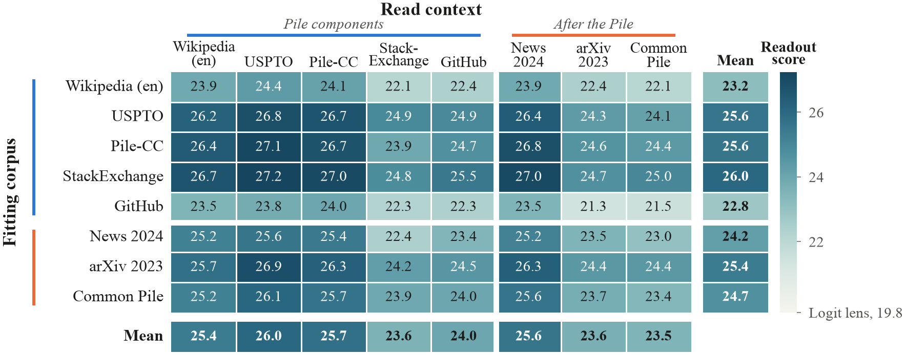

# The Fitting Corpus Is Part of the Measurement

Code and pre-registered experiments for *The Fitting Corpus Is Part of the Measurement: Auditing a
Jacobian Lens on Pythia*, Tarush Gupta, Interpretability as a Science Workshop at NeurIPS 2026.

[Paper (PDF)](paper/audit_paper_5pp.pdf) · [Artifacts on Hugging Face](https://huggingface.co/Tarush-AI/fittingcorpus) ·
[Experiment registry](docs/experiments/REGISTRY.md) · [Guide and glossary](docs/README.md)

## Overview

The Jacobian lens ([Gurnee et al., 2026](https://github.com/anthropics/jacobian-lens)) reads a
language model's hidden state at a middle layer by passing it through a linear map *J*, the model's
derivative of its final hidden state with respect to that layer, averaged over a corpus of prompts,
and then through the model's unembedding. The logit lens is the special case *J* = *I* and fits
nothing. Because *J* is an average, the Jacobian lens is a fitted measurement. The original work
shows that it needs few prompts, but does not vary which text the prompts are drawn from.

This repository varies it, on EleutherAI's Pythia suite, whose published training stream makes the
overlap between any corpus and the training data directly measurable. A corpus enters the
measurement in two roles: as the **fitting corpus** that *J* is averaged over, and as the **read
context**, the text placed before each test prompt. An 8 × 8 factorial crosses eight fitting corpora
with eight read contexts while holding the model, the evaluation prompts, the cached activations and
the scorer fixed. The **readout score** is the share of evaluation prompts whose annotated
intermediate concept appears in the lens's top *k* tokens at any layer of a fixed middle band,
averaged over *k* ∈ {1, 2, 5, 10, 20, 50, 100} and scaled to 0–100. The prompts are the 551 released
with the lens, in six families; one family is at the floor for every lens, so scores use the other five.



## Findings

Each finding names the experiment that establishes it, linked to its pre-registration, which states
the decision rule and names the results files to review. The other experiments that bear on the
finding follow it. Every experiment in the repository appears in exactly one row;
[`REGISTRY.md`](docs/experiments/REGISTRY.md) describes each one, grouped the same way.

| Finding | Provenance |
|---|---|
| **Fitting-corpus identity changes the readout.** Changing only the fitting corpus moves the Pythia-410M readout score from **22.8** (GitHub) to **26.0** (StackExchange), against **19.8** for the unfitted logit lens. The fitting corpus and the read context account for **53.4%** and **44.6%** of the variance among the 64 cells, with **2.0%** interaction, and fitting and reading on the same corpus confers no detectable advantage. | [**E52.3**](docs/experiments/preregs/R1_grid_rstrip.md): the 8 × 8 factorial, scored at the corrected readout, testing whether a map reads better on its own fitting corpus. Also E57 (the variance decomposition and its interval), E55 (stability under dropped corpora and on an independent 5 × 5 grid), E51, E36, E59, E33, E11. [All](docs/experiments/REGISTRY.md#f1-fitting-corpus-identity-changes-the-readout) |
| **The source, not sampling, separates the corpora.** Across disjoint document blocks of two sources, the source accounts for **0.972** of the fitting-axis variance under the pre-registered `persist` statistic (**0.989** under `min`), against a threshold of 0.70. | [**E72**](docs/experiments/preregs/R6_within_source_resampling.md): refits each of two sources on four disjoint document blocks and asks how much of the variance lies between sources. Also E80 (distances between the maps themselves), E27. [All](docs/experiments/REGISTRY.md#f2-the-source-not-sampling-separates-the-corpora) |
| **The effect is not lexical composition.** With the fitting pools matched on type-token ratio, the between-corpus spread is **22.2** pooled seed standard deviations under `persist` (**22.7** under `min`), above the pre-registered 20. | [**E74**](docs/experiments/preregs/R7_length_matched_pools.md): refits five corpora on pools matched on type-token ratio and measures the remaining spread. [All](docs/experiments/REGISTRY.md#f3-the-effect-is-not-lexical-composition) |
| **Training-stream containment does not explain the ordering.** Corpora with 32-gram containment below **0.002** read within the range of corpora above **0.92**, and the most contained corpus, GitHub (**0.934**), produces the weakest map. | [**E48.3**](docs/experiments/preregs/E48c_exposure_vs_read.md): correlates measured containment with the read across the eight fitting corpora. Also E35 (the containment index), E48. [All](docs/experiments/REGISTRY.md#f4-training-stream-containment-does-not-explain-the-ordering) |
| **The effect replicates across model scale.** At Pythia-1B and 2.8B the between-corpus spread and the agreement of the corpus ordering with 410M both meet criteria fixed before those models were scored. | [**E75**](docs/experiments/preregs/CV6_per_family_ladder.md): scores the five Pile corpora at 1B from existing maps (*N* = 200), refits them at 1.4B and 2.8B (*N* = 25), and tests the two criteria family by family. Also E62 (the 1B ladder on a corrected band), E53. [All](docs/experiments/REGISTRY.md#f5-the-effect-replicates-across-model-scale) |
| **More fitting data does not remove the effect.** From 25 to 800 prompts, the largest change in any corpus's score is **0.78** points, against a **2.46**-point spread between corpora: a ratio of 0.32, so the pre-registered flatness criterion of 0.25 is not met cleanly. | [**E28.3**](docs/experiments/preregs/R8_ladder_rstrip_S2.md): measures each corpus's movement over fitting-set size against the between-corpus spread, at the corrected readout. Also E18 (estimation error against *N*), E09, E14, E16. [All](docs/experiments/REGISTRY.md#f6-more-fitting-data-does-not-remove-the-effect) |
| **No measured statistic predicts the ordering.** None of **20** candidate statistics of the corpus or the map meets the pre-registered leave-one-corpus-out criterion. | [**E56**](docs/experiments/preregs/E56_predictor_registry.md): collects every candidate from the predictor screens and applies the criterion. The screens: E31, E34, E38, E44, E45, E46, E47, E50, E04, E12; E82 reconciles two of their numbers. [All](docs/experiments/REGISTRY.md#f7-no-measured-statistic-predicts-the-ordering) |

The controls, limits and checks behind those findings:

| Finding | Provenance |
|---|---|
| **What the readout score can and cannot show.** Pythia answers **3–6%** of the prompts at top-1 from 410M to 2.8B, so the results concern the readout score, not recovery of concepts the model represents. The corpus effect appears in raw scores, not only ranks; reading outside the positions the map was averaged over does not order the corpora; a map fitted on a weight-randomised network reads below the logit lens; and below 410M the fitted lens does not beat the logit lens. | [**E79**](docs/experiments/preregs/CV4_capability_ladder.md): answer competence at every model size. Also E78 (scores against ranks), E77 (read position), E61 (randomised network), E76, E65, E37, E07. [All](docs/experiments/REGISTRY.md#f8-what-the-readout-score-can-and-cannot-show) |
| **Layer-permutation nulls do not certify layer correspondence.** Under the published `min` statistic the real map loses to its own random layer derangements and beats the cyclic shifts of the band, so no claim rests on either null. Under `persist` and the band mean it beats both on 8 of 8 corpora. | [**E73**](docs/experiments/preregs/R9_permutation_calibrated_min.md) and [**E84**](docs/experiments/DA1_OUTCOME.md): the map against its own derangements, then against a second null family. Also E49, E54, E69, E81, E15, E17, E22, E67. [All](docs/experiments/REGISTRY.md#f9-layer-permutation-nulls-do-not-certify-layer-correspondence) |
| **The instrument, its configuration and the stored record are verified.** The released fitter runs correctly on Pythia, the configuration choices are measured rather than assumed, the source paper's item counts are reconciled with the released data, refits reproduce to within one fp16 storage step, and the script behind every stored result is obtainable. | [**Reproducibility record**](docs/reproducibility/README.md): what was checked and how. E00, E03, E10, E13, E19, E58, E60, E64, E66, E68, E70, E71, E83. [All](docs/experiments/REGISTRY.md#f10-the-instrument-its-configuration-and-the-stored-record-are-verified) |
| **The write side was explored and not carried into the paper.** The source's write interventions (coordinate swaps and ablations) were tried on Pythia early in the programme. | [**E05**](experiments/exploratory/descriptions/T5.md): the coordinate-swap battery. Also E08, E20, E21. [All](docs/experiments/REGISTRY.md#f11-the-write-side-explored-and-not-carried-into-the-paper) |

Results files are under `results/` on the Hugging Face mirror; experiment IDs and their old names
resolve in the registry.

## Reproducibility

| Tier | Reproduces | Requires | Cost |
|---|---|---|---|
| **T0** | every statistic, recomputed from the stored results | this repository and the results JSON | CPU, about a minute |
| **T1** | every read, re-scored from the stored fitted maps | the maps from the mirror (16.2 GB) | CPU, minutes to hours |
| **T2** | a sample of maps, refitted from the corpora | a GPU, fp32, TF32 disabled | GPU time |

Each tier assumes the one before it. T0 shows that every statistic in the paper follows from the
stored results; T1 shows that the stored reads follow from the stored maps; T2 checks that the
fitting step still produces those maps. The scripts in [`repro/`](repro/README.md) fetch what each
tier needs and rebuild the corpora at pinned revisions. What has been verified, with the stored
record of each check, is in [`docs/reproducibility/`](docs/reproducibility/README.md).

## Repository structure

A clone is about 9 MB: the code, every pre-registration and experiment document, the paper and the
figures it uses. The results, the fitted maps, the reference implementation and the corpus text are
not in the repository; the `repro/` scripts fetch or rebuild them.

```
fittingcorpus/
├── README.md · CITATION.cff · LICENSE · pyproject.toml · uv.lock
├── lab                 command-line entry point to the reproduction harness
├── corpora/            corpus manifests: per-file hashes, sources, pinned revisions
├── docs/
│   ├── experiments/     pre-registrations, write-ups, the experiment registry and provenance index
│   ├── context/         the programme narrative, claim grading, choice of band summary
│   ├── reproducibility/ what has been verified and how; artifact and mirror manifests
│   ├── validity/        whether the experiments measure what the paper claims
│   └── archive/         a restored document that pre-registrations link to
├── experiments/        the scripts that produce results
│   └── exploratory/     the first round of experiments and the predictor screens
├── figures/            figure generators, and the figures the paper uses
├── paper/              the paper (PDF and LaTeX source), bibliography and table generator
│   └── tools/
├── repro/              the reproduction harness
│   ├── exp/             one module per experiment, with the invocation that produced its result
│   ├── lib/             shared helpers
│   ├── scripts_at_run/  the exact bytes of every script version that produced a stored result
│   └── t1_sweep/        the harness of the full T1 sweep
├── src/                shared library: the map and fitter, evaluation battery and scorer,
│                       corpus builders, bootstrap, provenance stamping
├── tests/              unit tests
└── tools/              generators, ledgers and verification checks

Not in the clone; created by the repro/ scripts:
├── results/            results JSON (28.5 MB) and fitted maps (16.2 GB), from Hugging Face
├── jacobian-lens/      the reference implementation, cloned at 581d398
└── corpus text         rebuilt from public sources into corpora/, verified against the manifests
```

Script and results file names keep the historical IDs they were written under (`t52_factorial.py`,
`r6_within_source_410m.json`); the registry maps each to its experiment.

## License

Code: MIT. Results and fitted maps on Hugging Face: CC BY 4.0.
